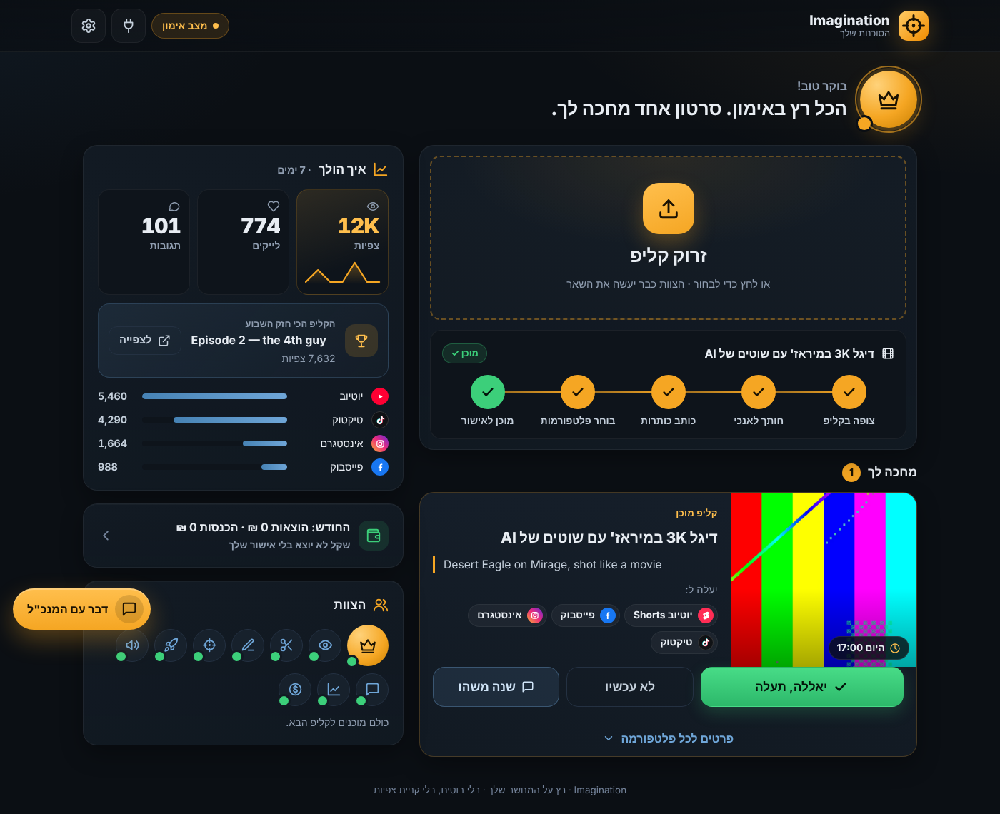
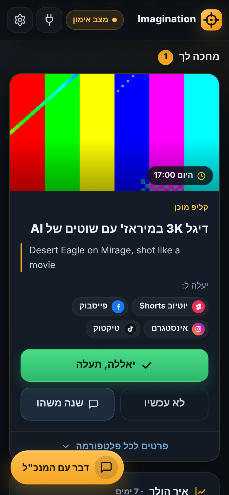
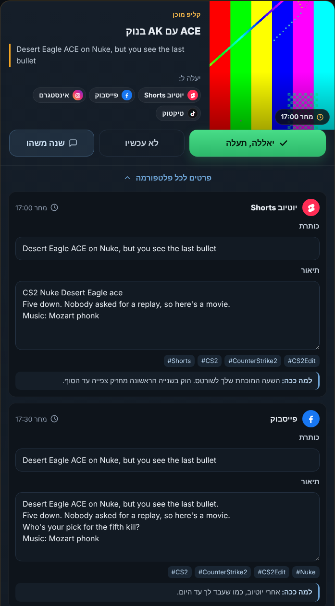
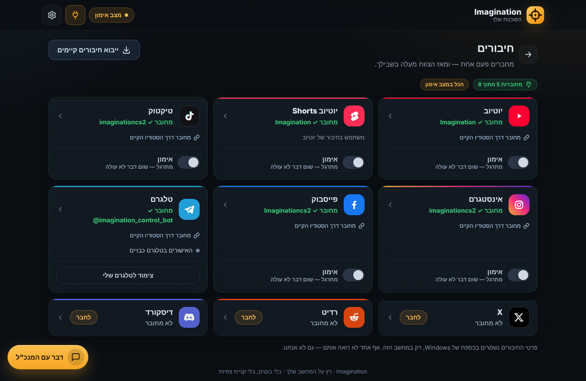

# Imagination Agency: סוכנות השיווק שלך ל-CS2

צוות קטן של עובדי AI שרץ על המחשב שלך, עם מנכ"ל אחד שמנהל אותו ומדבר איתך.
זורקים קליפ, והצוות חותך גרסאות, כותב כותרות, בוחר שעות ומחכה לאישור שלך.
לוחצים "יאללה, תעלה", והקליפ יוצא ליוטיוב, לטיקטוק, לאינסטגרם ולפייסבוק. הכל בעברית, בדפדפן.
הצוות חושב עם Claude שכבר מותקן אצלך — בלי עלות נוספת.

## איך זה נראה

 

התמונות מהדגמה: קליפ בדיקה ומספרים לדוגמה.

## כבר יש לך סטודיו? הסוכנות לוקחת ממנו את החיבורים לבד

יש לך את `C:\CS2_STUDIO`? מעולה. בפעם הראשונה שלוח הבקרה נפתח, מחכה לך כרטיס **"ייבוא מהסטודיו"**:

- הסוכנות לוקחת מהסטודיו את כללי המותג, את השעות שלך, את הפרטים של פייסבוק ואינסטגרם ואת כל מה שכבר עלה,
  כדי שהמספרים ימשיכו מאותו מקום.
- היא משתמשת בחיבורים שכבר שמורים במחשב, בלי להעתיק אותם.
- היא **לא משנה כלום בסטודיו הישן ולא מכבה אותו.** אם הוא עדיין פעיל, היא שואלת אותך שאלה אחת ומחכה לתשובה.
- היא גם לא מעלה פעמיים: קליפ שהסטודיו כבר העלה לאותה פלטפורמה לא יעלה שוב.
- עברת מחשב והמפתחות לא עברו איתך? החשבונות עצמם עדיין מחוברים אצל הפלטפורמות.
  מדביקים פעם אחת מפתח של **Zernio** (מחזיר את יוטיוב ואת טיקטוק), ואחריו את המפתח של **מטא** (פייסבוק ואינסטגרם).
  חלון החיבור מסביר בדיוק איפה ללחוץ.

## התקנה ב-Windows: 3 צעדים

1. **מורידים** את תיקיית הסוכנות, למשל ל-`C:\CS2_AGENCY` ליד הסטודיו. כל תיקייה עובדת, גם עם רווחים בשם.
2. **לוחצים פעמיים על `install.cmd`.** ההתקנה עושה הכל לבד. אין לך Python? היא תגיד לך בדיוק מה להקליד.
   בסוף היא שואלת שאלה אחת: להפעיל את הסוכנות לבד כשהמחשב נדלק? כדאי לענות כן, כי ככה קליפים שאישרת יוצאים בזמן.
3. **לוחצים פעמיים על האייקון "Imagination Agency"** בשולחן העבודה, ולוח הבקרה נפתח בדפדפן.

הסוכנות רצה ברקע בלי חלון. כדי לעצור או להפעיל מחדש: תפריט התחל ← Imagination Agency.
כדי לעדכן גרסה, מריצים שוב את `install.cmd`. ההגדרות והחיבורים נשמרים.

## הקליפ הראשון שלך

1. גוררים קליפ לאזור **"זרוק קליפ"**, או לוחצים עליו ובוחרים קובץ (בטלפון נפתחת הגלריה).
   אפשר גם לכתוב שורה אחת על מה שקרה בקליפ.
2. רואים את הצוות עובד, שלב אחרי שלב: צופה בקליפ ← חותך לאנכי ← כותב כותרות ← בוחר פלטפורמות ← מוכן לאישור.
3. בכרטיס **"מחכה לך"** בוחרים אחד מהכפתורים:
   - **"יאללה, תעלה"**: הקליפ יוצא בשעה שמופיעה בכרטיס.
   - **"לא עכשיו"**: הקליפ לא יעלה, והכרטיס יורד. התחרטת? פשוט זורקים את הקליפ שוב.
     (בטלגרם "לא עכשיו" רק משאיר את הכרטיס מחכה לך בלוח הבקרה.)
   - **"שנה משהו"**: פותח צ'אט עם המנכ"ל.
   ב"פרטים" אפשר לראות ולתקן את הכותרת והתיאור של כל פלטפורמה.
4. ב**"איך הולך"** רואים צפיות, לייקים ותגובות מהשבוע האחרון, ואת הקליפ הכי חזק שלך.
   המספרים מתעדכנים לבד כל כמה שעות.

קליפ קצר או אנכי עולה ליוטיוב פעם אחת, כ-Short. קליפ חדש לא נדחס לאותו יום עם קליפ שכבר מתוזמן: הוא מקבל את היום הפנוי הבא.

**הכל מתחיל במצב אימון.** במצב הזה הצוות עושה את כל העבודה חוץ מהעלאה אמיתית, אז אפשר לנסות בלי לחשוש.

רגיל לשים קליפים בתיקייה? בהגדרות מדליקים **"תיקיית קליפים"** (למשל `Desktop\CS2_CLIPS`),
וכל קליפ חדש שנכנס אליה מגיע לבד לאישור. קליפים שכבר היו בתיקייה לא נוגעים בהם.
הם מחכים תחת **"קליפים קודמים"** עם כפתור "תכין לפרסום".

## חיבור פלטפורמות

לוחצים על אייקון התקע (**חיבורים**) למעלה. כל פלטפורמה היא אריח: **"מחובר ✓"**, **"לא מחובר"** או **"צריך תיקון"**.
אין אינטרנט כרגע? האריח אומר **"החיבור שמור"** ובודק שוב לבד. זה לא אומר שמשהו התקלקל.

- לחיצה על אריח פותחת חלון חיבור, צעד אחרי צעד: הקישור המדויק, על מה ללחוץ ואיפה להדביק.
  אחרי ההדבקה הסוכנות בודקת את החיבור באמת ומראה את שם הערוץ.
- **יוטיוב, Shorts וטיקטוק** מתחברים דרך Zernio (מפתח אחד לשלושתם).
  **אינסטגרם ופייסבוק** מתחברים דרך האפליקציה שלך במטא.
- **"ייבוא חיבורים קיימים"** בראש העמוד מוצא חיבורים שכבר יש לך במחשב.
- **המתג "העלאה אמיתית"** בכל אריח מעביר רק את הפלטפורמה הזאת ממצב אימון להעלאה אמיתית.
  הסוכנות שואלת "בטוח?" לפני שהיא מדליקה אותו. כדאי להתחיל בפלטפורמה אחת.
- המדריך המלא, עם כל הצעדים לכל פלטפורמה: [docs/PLATFORMS_SETUP.md](docs/PLATFORMS_SETUP.md).

### לאשר מהטלפון

- **טלגרם:** מחברים את הבוט שלך בעמוד החיבורים, ומקבלים כרטיס עם "אשר הכל" ישר לטלפון.
- **לוח הבקרה בטלפון:** בהגדרות מדליקים **"גישה מהטלפון"** ומפעילים מחדש את הסוכנות
  (בתפריט התחל: **Imagination Agency** ← **Restart Imagination Agency**, או מפעילים מחדש את המחשב).
  אחר כך סורקים את הקוד שמופיע במחשב ונכנסים עם קוד בן 6 ספרות. זה עובד רק ב-Wi-Fi של הבית.

## בטיחות: 4 דברים

- **שום דבר לא עולה בלי האישור שלך** — אלא אם בחרת בהגדרות "תעלה לבד". הוצאות כסף תמיד מחכות לאישור שלך.
  המנכ"ל לא יכול לאשר במקומך, וזה נאכף בקוד.
- **כסף לא זז.** הסוכנות לא משלמת על כלום ולא מפעילה קידום ממומן. התקציב מתחיל ב-0 ₪.
- **המפתחות נשארים רק במחשב שלך**, בכספת של Windows. הם לא מוצגים על המסך ולא נשלחים לאף אחד.
- **בלי מעורבות מזויפת ובלי שקרים.** אין בוטים ואין קניית צפיות. אם העלאה נכשלה, תראה "נכשל" ולא הצלחה מזויפת.

## מצב מתקדם

בהגדרות יש מתג **"מצב מתקדם"**. הוא מראה יומן פעילות, טבלת סרטונים ופוסטים והמצב הטכני של כל פלטפורמה.
כל הפרטים הטכניים נמצאים ב-[docs/ADVANCED.md](docs/ADVANCED.md): פקודות, הגדרות, איך הסוכנות בנויה ואיך פותרים בעיות.
ב-Linux או macOS מריצים `bash install.sh` ואחר כך `bash start.sh`.

